# 👋 Hi, I'm Harshitha Dwaram!

<h1 align="center">Hey 👋 What's Up?</h1>

  Software Engineer | Computer Science Graduate | AWS & AI Enthusiast

  Passionate about building practical applications, solving problems, and exploring technologies that make software more useful and accessible.

###

<h2 align="left">💫 About Me</h2>

- 💼 Former Support Engineer Intern at **Amazon**, working on the Sherlock+ platform.
- 🎓 Computer Science graduate from Amrita Vishwa Vidyapeetham.
- 🔭 Interested in Software Engineering, Cloud Computing, and AI-powered applications.
- 🌱 Currently learning AI Engineering, RAG, and Distributed Systems.
- 💬 Ask me about Java, Python, SQL, AWS, and Data Structures & Algorithms.
- ⚡ Fun fact: I enjoy figuring out how things work behind the scenes!

###

<h2 align="center">🛠️ Tech Stack</h2>

  

###

<h2 align="center">🌐 Connect With Me</h2>

  
  

###

<h2 align="left">🚀 Featured Projects</h2>

<h3>🤟 Bidirectional Sign Language Communication System</h3>

A web application designed to facilitate communication between sign language users and non-signers.

- Built sign-to-text recognition using computer vision and deep learning.
- Developed text-to-sign functionality using sign representations.
- Integrated grammar validation to improve generated text.

**Technologies:** Python, Flask, TensorFlow, OpenCV, MediaPipe, JavaScript

<h3>🧠 Generating Synthetic Data with GANs</h3>

Explored Generative Adversarial Networks for synthetic data generation and machine learning applications.

**Technologies:** Python, Deep Learning, GANs

###

<h2 align="center">📊 GitHub Stats</h2>

  
  

 

<h2 align="center">🏆 GitHub Trophies</h2>

  

<h2 align="center">👾 Contribution Graph</h2>

<picture>
  <source media="(prefers-color-scheme: dark)" srcset="https://raw.githubusercontent.com/harshi-112/harshi-112/pacman-output/pacman-contribution-graph-dark.svg">
  <source media="(prefers-color-scheme: light)" srcset="https://raw.githubusercontent.com/harshi-112/harshi-112/pacman-output/pacman-contribution-graph.svg">
  
</picture>

###

  
  

###

<h2 align="center">✨ Developer Quote</h2>

  

###

  <i>Always learning. Always building. 🚀</i>

